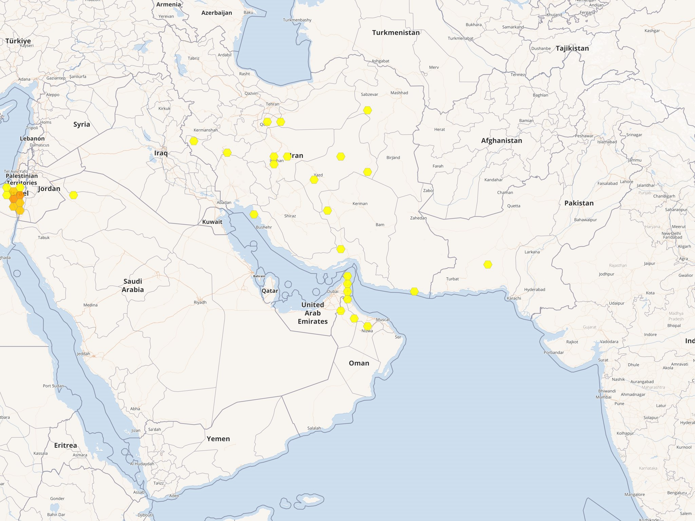

# گزیدگی افعی شاخ‌دار ایرانی

> [!warning]
> این فصل برای طبیعت‌گرد نوشته شده است، نه به‌جای پزشک و اورژانس. اگر کسی گزیده شد، درمان را از روی این متن شروع نکنید و منتظر «علامت قطعی» نمانید. همان لحظه با اورژانس پیش‌بیمارستانی (۱۱۵) تماس بگیرید و به نزدیک‌ترین بیمارستانی بروید که پادزهر مار دارد. مقدار پادزهر، برش زخم و هر داروی تزریقی فقط کار بیمارستان است.

افعی شاخ‌دار ایرانی، با نام علمی *Pseudocerastes persicus*، یکی از افعی‌های واقعی و زهرآگین ایران است. نام جنس، *Pseudocerastes*، یعنی «شاخ‌دارِ دروغین»: برآمدگی بالای هر چشم از چند فلس کوچک ساخته شده، نه از یک خارِ تک‌فلسی مثل افعی شاخ‌دار حقیقی جنس *Cerastes*. در فارسی به این گروه افعی شاخ‌دار می‌گویند. در انگلیسی نام رایج گونه Persian horned viper یا false-horned viper است.

این فصل همان مار را برای کسی می‌گوید که در زاگرس، کویرسنگی، تپهٔ آهکی یا دشت نیمه‌خشک راه می‌رود: مار را از دور بشناسد، بی‌جهت به آن دست نزند، و اگر گزش پیش آمد کار خطرناک نکند.

## این مار را چطور بشناسیم

بدن کلفت است، سر پهن و جدا از گردن، مردمک چشم در روشنایی عمودی است، و دم نسبتاً کوتاه. فلس‌های پشت لبهٔ میانیِ برجسته دارند و رنگ زمینه شنی، خاکستری یا قهوه‌ای کمرنگ است، با لکه‌های تیره‌تر که روی سنگ گم می‌شوند. برآمدگی بالای چشم در بچهٔ مار هم هست. این مجموع، سیمای یک افعی بیابانیِ کمین‌گیر است، نه یک مار باریک و تیزروی بیشه.

سر پهن، مردمک عمودی و برآمدگی شاخ‌مانند بالای چشم. این برآمدگی یک فلسِ خارمانندِ تنها نیست. عکس از زهیر عمرو.
منبع: [ویکی‌انبار، پروندهٔ Pseudocerastes persicus](https://commons.wikimedia.org/wiki/File:Pseudocerastes_persicus.jpg)

شکل سر و مردمک را معیار «سمی بودن» هر مار ایران نگذارید. بعضی مارهای کم‌خطر هنگام تهدید سر را پهن می‌کنند و بعضی مارهای خطرناک، از جمله کفچه‌مار، مردمک گرد دارند. اگر مار را نشناختید، فرض را بر خطر بگذارید و نزدیک نشوید.

رنگ شنی و لکه‌های تیره مار را روی سنگ تقریباً نامرئی می‌کند. دست را به شکاف و زیر تخته‌سنگ نبرید. عکس از امید مظفری.
منبع: [ویکی‌انبار، پروندهٔ Pseudocerastes persicus، عکس امید مظفری](https://commons.wikimedia.org/wiki/File:Pseudocerastes_persicus_(49819698718).jpg)

مار معمولاً از آدم دوری می‌کند. اگر پا به کنارش برسد، کسی رویش بنشیند، یا بخواهند آن را بگیرند، می‌گزد. «مرده» را هم با دست بر ندارید. راهنمای پیش‌بیمارستانی ایران می‌گوید گزش بازتابی ممکن است حتی تا حدود یک ساعت پس از مرگ مار رخ دهد. اگر عکس لازم است، از فاصلهٔ امن و با زوم بگیرید.

## سه گونهٔ نزدیک

جنس *Pseudocerastes* سه گونهٔ پذیرفته دارد. زهرشان یکی نیست. برای کمک‌های اولیه فرق عملی کمی هست: هر سه را گزش افعی حساب کنید و به بیمارستان بروید. فرق برای پزشک و برای شناخت مار در طبیعت مهم است.

**افعی شاخ‌دار ایرانی** (*Pseudocerastes persicus*) گسترده‌ترین گونهٔ جنس است. نام علمی از «پارس» می‌آید و نمونهٔ تیپ هم از ایران است. تخم‌گذار است. در ایران از گونه‌های مهم پزشکی شمرده می‌شود، کنار مار جعفری و افعی گرزه، هرچند در بیشتر پرونده‌های بیمارستانی اسم گونه نوشته نمی‌شود.

**افعی شاخ‌دار دم‌عنکبوتی** (*Pseudocerastes urarachnoides*) در سال ۲۰۰۶ از زاگرس غربی توصیف شد. دم کوتاه است و انتهاش پیازی، با فلس‌های دراز که هنگام تکان خوردن شبیه عنکبوت است. مار با همین طعمه پرنده را به کمین می‌کشد. در ایلام و کرمانشاه و زیستگاه آهکی غرب زاگرس دیده شده و از شرق عراق هم گزارش دارد. پراکنشش باریک است. محل دقیق را این‌جا تکرار نمی‌کنم تا جمع‌آوری غیرقانونی راحت‌تر نشود. اگر در مسیر طبیعت‌گردی دیدید، عکس از دور کافی است؛ مار را تعقیب و جابه‌جا نکنید.

افعی شاخ‌دار دم‌عنکبوتی در ایران. انتهای دم، طعمهٔ شکار است نه زائده‌ای بی‌خطر برای دست زدن. عکس از کیان کفترباز (Kian Kaftarbaz).
منبع: [ویکی‌انبار، Spider-tailed Horned Viper in Iran](https://commons.wikimedia.org/wiki/File:Spider-tailed_Horned_Viper_(Pseudocerastes_urarachnoides)_in_Iran.jpg)

همان ساختار دم از نمایی نزدیک‌تر: گرهٔ انتهایی و فلس‌های دراز. عکس از امید مظفری.
منبع: [ویکی‌انبار، پروندهٔ Pseudocerastes urarachnoides 2018](https://commons.wikimedia.org/wiki/File:Pseudocerastes_urarachnoides_2018.jpg)

**افعی شاخ‌دار فیلد** (*Pseudocerastes fieldi*) بیشتر مار شبه‌جزیرهٔ عربستان و شام است. قبلاً زیرگونهٔ *P. persicus* حساب می‌شد و امروز گونهٔ جداست، هم به دلیل ریخت و هم به دلیل تفاوت زهر. بودنِ جمعیت پایدارش در ایران محل اختلاف است: بعضی گزارش‌های جنوب و مرکز را *P. persicus* دانسته‌اند و بعضی حضور آن را در غرب و مرکز ایران نوشته‌اند. برای مسافر، نتیجه این است که اگر در غرب کشور مار شاخ‌داری دیدید، اسم دقیق را حدس نزنید.

افعی شاخ‌دار فیلد در عربستان سعودی، نه یک عکس از داخل ایران. شاخ‌نما بالای چشم در این جنس همین شکل را دارد. عکس از ماریوس بورگر (Marius Burger).
منبع: [ویکی‌انبار، نمای نزدیک Pseudocerastes fieldi](https://commons.wikimedia.org/wiki/File:Pseudocerastes_fieldi_close-up_in_Saudi_Arabia.jpg)

در جنوب‌غربی ایران افعی شاخ‌دار حقیقی (*Cerastes gasperettii*) هم هست، با یک فلسِ شاخ روی چشم. آن هم زهرآگین است. این فصل جای شرح گزش آن نیست. از دور اگر شک داشتید، همان فاصله را حفظ کنید.

## پراکنش و زیستگاه در ایران

*P. persicus* شاید گسترده‌ترین افعی این جنس در خاورمیانه باشد: از شمال عراق تا پاکستان، با جمعیت‌های جدا در کوه‌های جنوب‌شرقی شبه‌جزیرهٔ عربستان. در خودِ ایران در شرق، جنوب‌غرب و مرکز کشور هست؛ نمونهٔ زهرِ بررسی‌شده در مؤسسهٔ رازی از سمنان بوده و تنها گزارش بالینیِ مشخصِ اخیر از کرمان است. این دو نقطه فقط نشان می‌دهند مار به فلات مرکزی و جنوب‌شرق هم محدود نیست.

منبع: [GBIF، گونهٔ Pseudocerastes persicus](https://www.gbif.org/species/2443833) — داده‌های رخداد؛ کاشی‌های نقشه © GBIF / OpenMapTiles / OpenStreetMap contributors.

نقشه مشاهده‌های ثبت‌شده را نشان می‌دهد: شش‌ضلعیِ پرتراکم‌تر و نارنجی‌تر یعنی رکورد بیشتر، و این تراکم بازتاب تلاش مشاهده‌گر است، نه فراوانی واقعی مار. خوشهٔ شام (اسرائیل و اردن) به‌احتمال زیاد به گونهٔ نزدیک *Pseudocerastes fieldi* برمی‌گردد که قبلاً زیرگونهٔ *P. persicus* حساب می‌شد و در داده‌های قدیمی با همین نام آمده؛ آن لکه را پراکنش این گونه ندانید.

زیستگاه ترجیحی‌اش بیابان شنیِ روان نیست. سنگ آهک و بازالت، تپه و وادی، زمین نیمه‌خشک با بوتهٔ پراکنده، و سوراخ و شکاف را دوست دارد و معمولاً از آبادی دور می‌ماند. در زاگرس غربی با دم‌عنکبوتی هم‌جا می‌شود. در یک بررسی میدانی در منطقهٔ شکارممنوع بینا و بیجار (Bina & Bijar) در استان ایلام، هر دو گونه روی بستر آهکی، حدود ۸۰۰ تا ۱۰۰۰ متر، میان بنه و بلوط و انجیر دیده شدند. عدد ارتفاع سقف پراکنش را این‌جا قطعی نمی‌کنم؛ برای طبیعت‌گرد مهم این است که هم دامنهٔ زاگرس، هم تپهٔ سنگلاخی مرکز و شرق، زیستگاه ممکن است.

دم‌عنکبوتی به دامنهٔ غربی زاگرس چسبیده است: سنگ آهک، سوراخ عمیق، پوشش تنک. فصل گرم، غروب و شب، و کنار رودخانهٔ فصلی وقتِ دیده‌شدنِ هر دو است. روزها بیشتر در شکاف و سوراخ جونده می‌مانند.

در پایگاه خزندگان، گزارش‌های ترکیه و آذربایجان نامطمئن دانسته شده است. اگر نقشه‌ای در اینترنت این مار را تا هند یا قفقاز کشیده، به آن برای برنامه‌ریزی سفر تکیه نکنید.

## زهر و نشانه‌های گزش

زهر افعی مخلوط پروتئین است، نه یک سم واحد. در زهر *P. persicus* سمنان، فسفولیپاز A2، اکسیداز اسیدآمینه، متالوپروتئاز، سرین‌پروتئاز و مهارکننده‌های نوع کونیتز پیدا شده است. به زبان ساده: بخشی از زهر بافت و جدار رگ را آزرده می‌کند، بخشی روی التهاب و انعقاد اثر می‌گذارد. همین ترکیب در آزمایشگاه با اثر خون‌ریزی‌زا و آسیب بافتی جور درمی‌آید. این دادهٔ آزمایشگاهی است، نه شرح حال یک بیمار.

گزارش گزشِ قطعی کم است و باید محافظه‌کار ماند. در مرور مارهای مهم پزشکی ایران، تصویر بالینیِ رایج را درد و تورم موضعی نوشته‌اند که ممکن است با آسیب بافت و نکروز همراه شود؛ زهر از راه لنفاوی سطحی پخش می‌شود و تورم، رگه‌های لنفاوی و گاهی تاول آهسته پیش می‌رود. در منابع بالینی قدیمی‌تر، اختلال انعقاد و افت پلاکت هم به این گونه نسبت داده شده، اما بسیاری از آن پرونده‌ها با نمونه یا عکسِ تأییدشده همراه نبوده‌اند.

مورد مشخص و تازه این است: در استان کرمان، خزنده‌شناسی ۳۳ ساله از دست گزیده شد. درد موضعی و تورم گسترده پیدا کرد، از محل گزش خون آمد، نشانه‌های عمومی‌اش خفیف و غیراختصاصی بود، آنزیم عضلانی خون بالا رفت و نشانهٔ آزمایشگاهیِ اختلال انعقاد ناچیز بود. یعنی یک گزش تأییدشده می‌تواند بیشتر موضعی باشد و در عین حال تورمش کم نباشد. از یک مورد نمی‌شود نتیجه گرفت که گزش بعدی «حتماً سبک» است.

زهر دو خویشاوند در آزمایش فرق دارد و این فرق را نباید با حال بیمار یکی گرفت:

- زهر *P. fieldi* در مدل عصب‌ـ‌عضله اثر سمّیِ پیش‌سیناپسی دارد، یعنی از جنس زهرهایی است که پیام عصب به ماهیچه را قطع می‌کنند. با این حال معدود گزش‌های انسانیِ ثبت‌شده در خاورمیانه عمدتاً موضعی بوده‌اند و بیماران زنده مانده‌اند. اگر دوبینی، افتادگی پلک، اشکال در بلع یا تنگی نفس دیدید، آن را به حساب ترس نگذارید و به تیم درمان بگویید.
- زهر *P. urarachnoides* در پلاسمای انسان لخته‌سازی قوی نشان داده و فاکتور ۱۰ و پروترومبین را فعال کرده است. گزارش بالینی از گزش این گونه تقریباً نیست. تا وقتی خلافش ثابت نشده، گزش دم‌عنکبوتی را از نظر اختلال انعقاد جدی بگیرید. این پیش‌بینیِ آزمایشگاهی است، نه آمار بیمارستانی.

هر ضربه‌ای زهر تزریق نمی‌کند. در ایران و جهان، سهمی از گزش مارهای زهرآگین «گزش خشک» است و اثر موضعی یا عمومیِ مهم ندارد؛ رقمی که در مرورها آمده دست‌کم حدود ۲۰ درصد است و در بعضی گروه‌ها خیلی بیشتر. این را در صحرا تشخیص ندهید. تورم افعی اغلب در یکی دو ساعت اول پیدا می‌شود، اما اثر عمومی ممکن است دیرتر برسد. کودکی که آرام شده دلیل خوب بودن حالش نیست. سازمان جهانی بهداشت هم تأکید می‌کند که کودکان، به‌خاطر جثهٔ کوچک‌تر، ممکن است شدیدتر آسیب ببینند.

نشانه‌هایی که باید به بیمارستان بگویید، بی‌آنکه خودتان شدت را درجه‌بندی کنید: درد و سوزش، تورم رو به بالا، کبودی، تاول، خون‌ریزی از محل گزش یا از لثه و بینی، تهوع، استفراغ، سرگیجه، ضعف، درد شکم، افت هوشیاری، و هر نشانه‌ای در پلک و گفتار و تنفس. دو سوراخ نیش شایع است، ولی یک سوراخ، خراش، یا جای نامشخص هم گزش را رد نمی‌کند.

## پیشگیری برای طبیعت‌گرد

در فاصلهٔ سال‌های ۲۰۰۲ تا ۲۰۱۱، مراکز درمانی ایران ۵۳٬۷۸۷ مورد مارگزیدگی ثبت کردند. بروز سالانه در این دهه از ۴٫۵ تا ۹٫۱ در هر ۱۰۰٬۰۰۰ نفر نوسان داشت و حدود ۶۷ مرگ در کل دهه ثبت شد. بیشترین موارد از جنوب و جنوب‌غرب کشور بود. این رقم همهٔ گونه‌ها را یکجا نشان می‌دهد و سهم افعی شاخ‌دار از آن جدا نشده است. کم‌شماری هم ممکن است، پس این عدد سقفِ واقعیِ خطر نیست.

بیشتر گزش‌های ایران در بهار تا پاییز است، وقتی هم مار فعال‌تر است و هم آدم بیشتر بیرون است. این مار شب و غروب بیشتر دیده می‌شود و روز در شکاف پنهان است. پیشگیری از درمان ساده‌تر است.

- در سنگلاخ و دامنه، چکمه یا کفش ساقدار و شلوار بلند بپوشید. صندل برای عبور از وادی و بلوط‌زار انتخاب بدی است.
- دست و پا را در شکاف، زیر کنده، لانهٔ جونده و داخل کولهٔ باز نکنید. اول با چوب بزنید تا اگر چیزی هست تکان بخورد.
- محل نشستن را نگاه کنید: تخته‌سنگ گرم، سایهٔ بوته، و دهانهٔ غار کوچک جای کمین است.
- شب چراغ پیشانی یا چراغ دستی رو به زمین داشته باشید، نه فقط رو به افق.
- کفش، کیسهٔ خواب و چادر را قبل از استفاده بتکانید. اگر می‌شود روی تخت صحرایی بخوابید و لبهٔ چادر را ببندید.
- چوب و سنگ را برای کشتن مار برندارید. تعقیب، عکس خیلی نزدیک و «گرفتن برای شناسایی» خودش علت گزش است.
- بچه را جلوتر از گروه روی سنگ‌ها رها نکنید.
- در دره‌ای که آنتن نیست تنها راه نیفتید، یا دست‌کم مسیر و ساعت برگشت را به کسی بگویید. همراه، برای حمل مصدوم تعیین‌کننده است.

اگر مار را دیدید مسیر را عوض کنید. لازم نیست بشناسیدش. اگر در کمپ بود، با نور از دور مطمئن شوید رفته و بعد وسایل را جابه‌جا کنید.

## کمک‌های اولیه

هدف کمک اولیه این است که مصدوم زنده و آرام به درمان برسد و کسی آسیب تازه‌ای به او نزند. هم راهنمای پیش‌بیمارستانی کشور (مرکز مدیریت حوادث و فوریت‌های پزشکی، با همکاری بخش مسمومیت بیمارستان لقمان) و هم صفحهٔ درمان سازمان جهانی بهداشت روی همین نکته‌اند: روش‌های سنتیِ آشنا بیشتر ضرر دارند تا فایده.

### این کارها را بکنید

۱. صحنه را امن کنید. مصدوم را از محدودهٔ مار دور کنید. اگر مار هنوز به بدن چسبیده، با چوب جدا کنید، نه با دست.
۲. با ۱۱۵ تماس بگیرید. بگویید مارگزیدگی است، ساعت تقریبی گزش را بگویید، و نزدیک‌ترین مرکز دارای پادزهر را بپرسید. اگر آنتن نیست، یک نفر به سمت جاده یا روستا برود و بقیه کنار مصدوم بمانند.
۳. مصدوم را بنشانید یا بخوابانید. راهنمای ایرانی برای مار، عضو گزیده‌شده را افقی می‌خواهد، نه آویزان. حرکت عضله جذب زهر را زیاد می‌کند.
۴. انگشتر، النگو، ساعت، پابند و لباس تنگ را همان اول دربیاورید، پیش از آن که تورم راه را ببندد.
۵. عضو را با آتل، باند پارچه‌ای یا چوب و شال بی‌حرکت کنید. مفاصل دو طرف گزش هم بهتر است تکان نخورند. به زخم فشار موضعیِ سفت وارد نکنید.
۶. مصدوم را حمل کنید. برانکارد، صندلیِ دست‌ساز یا ویلچر از راه رفتن بهتر است. اگر پای گزیده‌شده تنها راه خروج است و حمل ممکن نیست، آهسته حرکت کنید و همان عضو را کمتر به کار بگیرید. ماندن تا «ببینیم ورم می‌کند یا نه» انتخاب بدتری است.
۷. اگر استفراغ محتمل است، مصدوم را به پهلوی چپ، در وضعیت بهبودی، بخوابانید و راه هوایی را نگاه کنید. اگر تنفس قطع شد، احیای قلبی‌ریوی را کسی انجام دهد که آموزش دیده است.
۸. ساعت گزش و لبهٔ تورم را با خودکار روی پوست علامت بزنید تا پزشک سرعت پیشرفت را ببیند. عکس مار، اگر بی‌خطر گرفته شده، به تیم درمان نشان داده شود. لاشه را فقط اگر از قبل مرده است و با ابزار، نه با دست لخت، همراه ببرید.

سازمان جهانی بهداشت برای درد موضعی استامینوفن را ممکن دانسته است. مقدارش را این‌جا نمی‌آورم. آسپرین و ایبوپروفن در گزش افعی انتخاب خوبی نیستند، چون خون‌ریزی ممکن است. به کودک هیچ دارویی ندهید مگر اورژانس یا پزشک همان لحظه گفته باشد. الکل ندهید.

اگر شستن زخم درمان را عقب نمی‌اندازد، آب ساده کافی است. زخم را نتراشید و رویش ماده نریزید. اولویت با بی‌حرکتی و حرکت به سمت بیمارستان است.

### این کارها را نکنید

این فهرست را راهنمای ایرانی و سازمان جهانی بهداشت، هر دو، رد کرده‌اند:

- بریدن، تیغ زدن، خراشیدن یا سوراخ کردن جای گزش
- مکیدن زخم با دهان یا با دستگاه مکنده
- تورنیکهٔ سفت دور بازو یا ران. این کار دردناک است و می‌تواند عضو را از خون بیندازد. وقتی هم باز شود، ممکن است حال عمومی یک‌باره بد شود
- باند فشاریِ مخصوص بعضی مارهای عصبی (روش استرالیایی pressure-immobilisation). سازمان جهانی بهداشت آن را فقط برای گزش مارهای عصبی‌ای می‌گوید که تورم موضعی نمی‌دهند. راهنمای ایرانی هم بستن باند برای به تأخیر انداختن لنف را ویژهٔ کفچه‌مار دانسته و برای افعی، به‌سبب آسیب موضعی، مناسب ندانسته است. افعی شاخ‌دار تورم موضعی می‌دهد. برای این گزش آن باند را نبندید
- شوک الکتریکی، سنگ سیاه، گیاه، خمیر، مواد شیمیایی، باروت، یا داغ کردن
- کیسهٔ یخ و خواباندن عضو در آب یخ. راهنمای ایرانی می‌گوید سرما ممکن است آسیب بافت را بیشتر کند
- الکل، و هر نوشیدنی که استفراغ را بدتر کند
- دویدنِ مصدوم «تا زهر بسوزد»

آرام کردن مصدوم به‌معنی سبک شمردن حادثه نیست. بگویید بیشتر گزش‌ها با رسیدن به‌موقع به بیمارستان قابل اداره شدن‌اند، و همزمان واقعاً راه بیفتید.

## درمان در بیمارستان و پادزهر مؤسسهٔ رازی

تنها درمان اختصاصیِ مسمومیت با زهر مار، پادزهر مناسب است و آن هم فقط وقتی که پزشک نشانهٔ مسمومیت ببیند. گزش خشک پادزهر نمی‌خواهد. تشخیص این مرز با آزمایش و معاینه است، نه با حالِ ساعت اول در کوه.

در ایران، مؤسسهٔ تحقیقات واکسن و سرم‌سازی رازی سال‌هاست پادزهر چندظرفیتی مار می‌سازد. فرآورده پادتن اسب است که به قطعهٔ F(ab')2 شکسته شده. در مرور سال ۲۰۲۳، دو شکل رایج این‌طور وصف شده است:

- پنج‌ظرفیتی، علیه زهر پنج مار مهم پزشکی: مار جعفری (*Echis carinatus*)، افعی گرزه (*Macrovipera lebetina*)، افعی رادهای / زنجانی به نام قدیمی‌تر (*Montivipera raddei*)، افعی قفقازی (*Gloydius caucasicus*) و افعی شاخ‌دار ایرانی (*Pseudocerastes persicus*)
- شش‌ظرفیتی، با افزودن کفچه‌مار یا کبرای آسیای میانه (*Naja oxiana*)، برای شمال‌شرق کشور که این گونه آن‌جا گزارش می‌شود

پایگاه پادزهر مونیخ (MAVIN) هم *Pseudocerastes persicus* را جزو موارد فهرست‌شدهٔ پادزهر چندظرفیتی رازی آورده است. پس این گونه در طراحی پادزهرِ رایج کشور جا دارد. بیمار و همراه نباید نوع ویال یا تعداد آمپول را از حفظ مطالبه کنند. بیمارستان همان ترکیبی را دارد که برای همان منطقه توزیع شده، و دوز شروع در بروشور کارخانه و در پروتکل سم‌شناسان کشور یکسان نیست. این اختلاف را پزشک حل می‌کند، نه راهنمای سفر.

دو محدودیت را صریح بگویم. اول، زهر *P. fieldi* و به‌ویژه *P. urarachnoides* با زهر *P. persicus* در آزمایش خیلی فرق دارد و پژوهشی که این تفاوت را نشان داد، نسبت به پوشش متقاطع پادزهر رازی هشدار داده است. یعنی نمی‌شود فقط به‌خاطر خویشاوندیِ اسمی مطمئن بود که همان ویال، زهر دم‌عنکبوتی یا فیلد را هم کامل خنثی می‌کند. این شک، دلیل نرفتن به بیمارستان نیست. درمان موجود همان پادزهر چندظرفیتی به‌اضافهٔ مراقبت حمایتی است تا دادهٔ بهتر منتشر شود. دوم، ترکیب تجاری ممکن است با ویال تازه‌تر عوض شده باشد. برچسب همان آمپولی که در بیمارستان باز می‌شود معتبر است، نه متن این فصل.

کنار پادزهر، کار بیمارستان مراقبت است: راه هوایی، فشار خون، مایع وریدی اگر لازم باشد، آزمایش انعقاد و پلاکت و کلیه و آنزیم عضلانی، پیگیری تورم، مراقبت زخم، و وضعیت کزاز. پادزهر چون از سرم اسب می‌آید می‌تواند حساسیت بدهد و باید جایی تزریق شود که تیم درمان بتواند واکنش را جمع کند. این دلیلِ تزریق در خانه یا در چادر نیست.

برش زخم و فاشیوتومیِ زودهنگام در راهنماهای معتبر توصیه نمی‌شود و در ایران هم از اقدام‌هایی است که هنوز گاهی انجام می‌شود و خودش خون‌ریزی، عفونت و بستری طولانی می‌سازد. اگر پزشکی آن را پیشنهاد کرد، حق دارید بپرسید فشار داخل کمپارتمان اندازه گرفته شده یا نه. این سؤالِ همراه است، نه دستور.

حتی اگر ساعت اول حال عمومی خوب بود، بیمارستان را به میل خود ترک نکنید. اثر عصبی بعضی مارها و اختلال انعقاد ممکن است با تأخیر برسد و کودک ممکن است زودتر بد شود. گزش صورت و گردن خطر تنفس را جداگانه دارد.

اگر دیر به درمان رسیدید، باز هم بروید. «ساعت طلایی» را بهانه‌ای نکنید که بعد از چند ساعت دیگر فایده‌ای ندارد. هرچه زودتر بهتر است، و دیر رسیدن هنوز از نرسیدن بهتر است.

## جمع‌بندی برای کوله‌پشتی

افعی شاخ‌دار ایرانی مار زهرآگینِ سنگ و تپه است، در زاگرس و در بخش بزرگی از ایران، با رنگِ هم‌رنگ سنگ. خویشاوند دم‌عنکبوتی‌اش بومی غرب زاگرس است و با دم شکار می‌کند. گزش تأییدشده می‌تواند با درد و تورم گسترده باشد و همیشه یک تابلوی نمایشیِ فوری ندارد. کار شما در طبیعت این است که گزش پیش نیاید، و اگر آمد: دور شدن، آرام ماندن، درآوردن انگشتر، آتل، حمل، و بیمارستان. بریدن و مکیدن و تورنیکه را برای هیچ مار ایرانی انجام ندهید.

## منابع همین فصل

منابع زیر در [[Bibliography|کتاب‌نامه]] و [[MOC - Sources|فهرست منابع]] هم ثبت شده‌اند. یادداشت هر منبع در پوشهٔ پژوهش است.

- [[WHO - برگهٔ مارگزیدگی]] — برآورد جهانی گزش، مرگ، و آسیب‌پذیری کودکان.
- [[WHO - درمان مارگزیدگی]] — کمک اولیه: چه بکنیم و برش، مکش و تورنیکه را چرا کنار بگذاریم.
- [[راهنمای پیش‌بیمارستانی گزش]] — راهنمای اورژانس ایران با همکاری بخش مسمومیت لقمان.
- [[دههٔ مارگزیدگی در ایران]] — آمار ۱۳۸۱ تا ۱۳۹۰ بر پایهٔ پرونده‌های درمانی.
- [[مارهای مهم پزشکی ایران]] — پراکنش، تابلوی بالینی، و پادزهر رازی.
- [[گزارش گزش افعی شاخ‌دار در کرمان]] — تنها گزارش بالینیِ مشخص و تازه‌ای که این فصل به آن تکیه می‌کند.
- [[تفاوت زهر افعی‌های Pseudocerastes]] — تفاوت آزمایشگاهی زهر سه گونه و هشدار دربارهٔ پادزهر.
- [[پروتئوم زهر افعی شاخ‌دار سمنان]] — ترکیب زهر نمونه‌های سمنان در آرشیو مؤسسهٔ رازی.
- [[پادزهر چندظرفیتی رازی]] — فهرست گونه در پایگاه MAVIN.
- [[پایگاه خزندگان - Pseudocerastes persicus]] — نام علمی، پراکنش و تذکر دربارهٔ گزارش‌های مشکوک.
- [[GBIF - پراکنش Pseudocerastes persicus]] — نقشهٔ تراکم مشاهده‌های ثبت‌شده، با تذکر دربارهٔ خوشهٔ شام.
- [[هم‌زیستی در زاگرس غربی]] — دیدن *P. persicus* و *P. urarachnoides* در یک زیستگاه آهکی ایلام.
- [[توصیف افعی دم‌عنکبوتی]] — مقالهٔ توصیف گونه در سال ۲۰۰۶.

## پیوندها
- [[مارگزیدگی|بخش مارگزیدگی]]
- [[MOC - Concepts|مفاهیم]]
- [[TOC|فهرست مطالب]]
- [[Outline|طرح کلی]]
- [[Book Home|خانهٔ کتاب]]
